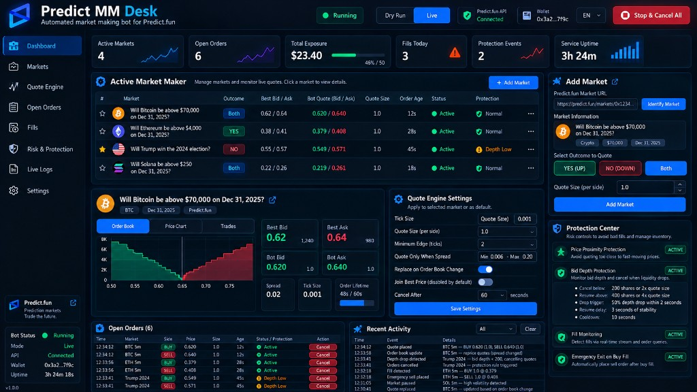

# Predict.fun Market Making Bot



[简体中文](README.md) | [English](README.en.md)

A passive market-making bot for [Predict.fun](https://predict.fun). It quotes selected markets from the live order book, replaces stale orders, and cancels them when price or depth conditions become unsafe. You control it from an English web dashboard on Windows or on an Ubuntu/Debian server.

Any order resting on the book can fill. Emergency sells are not guaranteed to execute, and they are not guaranteed to execute at a particular price. Use dry-run mode first, then start with a small size.

## Contents

- [What the bot does](#what-the-bot-does)
- [Requirements](#requirements)
- [Quoting behavior](#quoting-behavior)
- [Risk controls](#risk-controls)
- [Dashboard](#dashboard)
- [Account setup](#account-setup)
- [Windows desktop app](#windows-desktop-app)
- [Server installation](#server-installation)
- [Command-line use](#command-line-use)
- [Configuration](#configuration)
- [Security](#security)

## What the bot does

The bot posts limit buy quotes for the outcomes you select. It does not chase the market with market orders. For each enabled market it reads the order book, checks spread and risk limits, then submits a post-only limit order through the official Predict.fun API.

While it is running it will:

- Refresh quotes when the order book changes, or when an order reaches the end of its configured lifetime.
- Cancel a quote when the market price moves too close to it.
- Cancel a quote when the bids in front of it become too thin or drop quickly, then resume after depth recovers.
- Watch wallet events and order status for buy fills.
- After a buy fill, optionally pause that market and submit a limit sell.
- Cancel the orders it manages when it starts and when it stops.

Signed limit orders expire 300 seconds after they are created. Canceling an order removes it from the public book. The short expiry limits how long a signature could still be used if the process or the network disappears before the cancel is confirmed.

## Requirements

- A Predict.fun account, an API key from [Predict.fun Developers](https://developers.predict.fun/), and the private key of the wallet that signs orders.
- A small BNB balance on the signing wallet if you set on-chain trading approvals. Predict Account users must send that BNB to the Privy signing wallet, not to the Predict Account deposit address.
- Windows 10/11 64-bit for the desktop app, or Ubuntu/Debian with Python 3.11 or newer for the server. Ubuntu 24.04 is the recommended server image.
- Microsoft Edge WebView2 Runtime on Windows. Install it from [Microsoft](https://developer.microsoft.com/microsoft-edge/webview2/) if the app reports that it is missing.

Use a wallet dedicated to the bot. Do not use a wallet that holds unrelated funds.

## Quoting behavior

The default strategy is a passive maker. It quotes inside the current spread rather than joining the best bid and best ask. The default offset is 2 ticks. Tick size comes from the market. If the market does not leave enough room for that offset, the bot keeps a valid quote at the minimum tick instead of dropping the market.

You can quote Yes, No, or both. A No bid is priced from the complement of the Yes ask, because Predict.fun expresses the book in Yes prices.

The bot skips a market when either side of the book is missing, or when the spread is outside the configured range. The default range is 0.006 to 0.20. On a 0.001-tick market, a one-tick spread is still eligible.

Each market has its own order size. Position limits are shared: the default cap is 10 shares per market and 50 shares in total. Quotes above those limits are not sent.

## Risk controls

| Control | Default | What it does |
| --- | --- | --- |
| Order lifetime | 60 seconds | Cancels and requotes after the lifetime. If the best bid, best ask, and target price are unchanged, the order may remain for one extra period of the same length. Price proximity still cancels immediately. |
| Price proximity | Enabled | Cancels when the market approaches a resting order. If the live book connection drops, the bot falls back to periodic checks. |
| Bid depth protection | Enabled | Cancels when external bids strictly above your buy price are below `max(200 shares, 2 × order size)`, or when that depth falls by 50% inside 2 seconds and the remainder is below the resume threshold. Yes and No are evaluated separately. Your own orders are excluded. |
| Depth recovery | 400 shares or 4 × size | Resumes only after a 10-second cooldown and 3 seconds of stable depth. The bot checks depth again before submitting. |
| Session duration | Off | Optional countdown from the moment you start the bot. At expiry it cancels all managed orders and stops. Maximum 72 hours. |
| Emergency sell | On | After a full or partial buy fill, cancels the bot's other orders in that market and submits a non-post-only limit sell. The limit is 0.001 when the market tick is 0.001, otherwise 0.01. This can sell shares you already held, and it can lose money. |
| Dry run | Off | Calculates quotes and writes logs without placing orders. On the official API, dry run uses a sample book instead of the live book. |

Depth protection can reduce how often you quote. It cannot promise that an order will not fill.

Live trading also requires trading approvals. **Check approvals** only reads status. **Set approvals** sends BNB Chain transactions through the official Predict SDK and spends gas from the signing wallet. It does not place a prediction-market order. The bot refuses to start live quoting until the required approvals are present.

## Dashboard

The interface is English. Market names keep the language returned for the URL you paste. Activity logs keep their original text.

| Page | Purpose |
| --- | --- |
| Dashboard | Bot status, USDT balance, open orders, session time remaining, and recent logs. |
| Account settings | API key, signing private key, and optional Predict Account address. Saving creates the JWT locally. |
| Quote settings | Markets, size, lifetime, session duration, emergency sell, dry run, and depth thresholds. |
| Activity logs | Quoting, cancellation, and fill-protection records. Selecting text pauses auto-refresh. |

The balance shown is the on-chain USDT balance of the trading account. It does not include the mark-to-market value of open positions.

Opening the dashboard does not start quoting. Click **Start bot** after the account and markets are saved. **Stop & cancel orders** requests a stop and cancellation. **Cancel orders in all markets** cancels managed orders without a separate start.

## Account setup

1. Request an API key from [Predict.fun Developers](https://developers.predict.fun/).
2. On the Predict.fun website, open your profile and copy the wallet address shown under your username. This is the Predict Account address. Leave it blank if you trade from an externally owned account (EOA).
3. Export the signing key. For a Predict account, use the Privy wallet key from the profile or settings menu. For an EOA, use that wallet's private key.
4. In **Account settings**, enter the API key, private key, and Predict Account address if you use one. Click **Save account settings**. The private key is stored only in the local `.env` file. The dashboard shows whether a key is saved, not the key itself.
5. Save at least one market in **Quote settings**.
6. Open **Account settings**, click **Check approvals**, and click **Set approvals** if any step is missing. Fund the gas wallet address shown on that page with a small amount of BNB first.
7. For a brand-new wallet, complete one trade on the official website before relying on the bot. That establishes the account state the current approval flow expects.
8. Return to **Dashboard** and click **Start bot**.

## Windows desktop app

1. Extract `PredictMMBot-Windows-x64.zip`.
2. Keep `PredictMMBot.exe` and the `_internal` folder in the same directory.
3. Double-click `PredictMMBot.exe`.
4. Save **Account settings** and **Quote settings**, then click **Start bot**.

Python is not required. The Windows build is a preview. Only one window can run at a time, because both windows would trade against the same local order journal.

A normal close asks the bot to stop and waits for cancellation to finish. If cancellation cannot be confirmed, the window stays open and shows the error. Sleep, shutdown, and force-quit interrupt the local process and can leave orders that the bot did not cancel.

Settings, logs, and the order journal are stored in `%LOCALAPPDATA%\PredictMMBot`, outside the application folder. Do not send that folder or its `.env` file to anyone. To update, stop the bot, close the window, and extract the new build into a new folder. The existing settings remain in the data directory.

For unattended operation, use the server installation below. A desktop session stops when the computer sleeps.

## Server installation

Copy this project to the server, sign in with SSH, and run the installer from the project directory:

```bash
sudo bash install.sh
```

If you are already `root`, omit `sudo`. The installer supports Ubuntu and Debian, and it requires Python 3.11 or newer. It installs a virtual environment and the Python dependencies, copies the program to `/opt/predict-mm-bot`, and creates a systemd service named `predict-mm-bot`. The service listens on `127.0.0.1:8080` and starts again after a reboot. It does not start live quoting by itself.

The installer refuses to continue if port 8080 is occupied by an unrecognized process, or if the bot is already running. It keeps an existing `.env`, `config.toml`, and `logs` directory. On the first switch from an older manual install, it can copy those files from `/root/predict-mm-bot` when the new install does not already have them.

To update, click **Stop & cancel orders**, replace the program files, and run `sudo bash install.sh` again.

The dashboard is bound to loopback. From your own computer, open an SSH tunnel and leave that terminal open:

```bash
ssh -L 8080:127.0.0.1:8080 username@server-ip
```

Then open `http://127.0.0.1:8080`. Closing the tunnel only closes your browser path. The service, and a bot you already started, keep running on the server. Reconnect the tunnel after your computer sleeps or restarts.

Start the service if it is stopped, wait until it answers, and start the bot with the saved configuration:

```bash
sudo systemctl start predict-mm-bot
timeout 30 bash -c 'until curl -fsS http://127.0.0.1:8080/api/status >/dev/null; do sleep 1; done'
curl -fsS -X POST http://127.0.0.1:8080/api/start
```

Follow the service log:

```bash
sudo journalctl -u predict-mm-bot -f
```

Restart the dashboard service with:

```bash
sudo systemctl restart predict-mm-bot
```

Click **Stop & cancel orders** before a restart or an update. A service restart brings the dashboard back. It does not resume quoting until you start the bot again.

## Command-line use

From a source checkout you can configure and run the bot without the dashboard. Python 3.11 or newer is required. Install the project first:

```bash
python -m pip install -e .
python -m predict_mm.main --setup
python -m predict_mm.main --config config.toml
```

`--setup` writes `.env` and `config.toml` in the working directory and exits. A later run with `--config` loads those files. Add `--no-setup` to fail instead of opening the wizard when either file is missing.

The web dashboard can also be started directly:

```bash
python -m predict_mm.web --host 127.0.0.1 --port 8080
```

Leave the host on `127.0.0.1`. The dashboard has no login of its own.

## Configuration

The dashboard writes the same two files the command-line runner reads.

`.env` holds account credentials:

```bash
PREDICT_API_BASE_URL=https://api.predict.fun
PREDICT_API_KEY=
PREDICT_JWT_TOKEN=
PREDICT_PRIVATE_KEY=
PREDICT_ACCOUNT_ADDRESS=
LOG_LEVEL=INFO
```

`PREDICT_API_BASE_URL` defaults to the official API. REST requests follow that value. The order-book and wallet WebSocket remains `wss://ws.predict.fun/ws`. The JWT can be left empty; saving the account in the dashboard creates it, and the bot refreshes it when Predict.fun rejects an expired token.

`config.toml` holds markets and risk settings. `config.example.toml` is a complete starting point. Fields you will change most often:

| Field | Meaning |
| --- | --- |
| `dry_run` | `true` simulates quoting. `false` places real orders. |
| `cancel_after_seconds` | Order lifetime before a refresh. |
| `run_duration_seconds` | `0` means no automatic stop. |
| `emergency_exit_on_buy_fill` | Submit the protective sell after a buy fill. |
| `markets` | One entry per market, with `id`, `outcome`, and `quote_size`. |
| `risk.max_position_per_market` | Maximum position in one market. |
| `risk.max_total_position` | Maximum position across markets. |
| `depth_protection` | Cancellation and resume thresholds. Resume values must be higher than cancel values. |

Outcome is `YES`, `NO`, or both. Quote size is in shares.

## Security

- The private key is used locally to sign the Predict.fun login message and orders. The dashboard does not display it after it is saved.
- `.env` and `config.toml` are excluded from Git. Do not commit them, paste them into a chat, or include them in a screenshot.
- The server installer sets those files to mode `0600` and runs the service as the unprivileged `predictmm` user, bound to loopback.
- Do not publish port 8080. Anyone who can open the dashboard can start the bot with the saved key.
- Trading approvals allow Predict.fun contracts to move the approved assets for trading. Set them only for the wallet you intend to use with this bot.
- After every live session, compare the bot's open orders with the orders shown on Predict.fun. Startup and shutdown cancellation applies to orders this process is managing.
